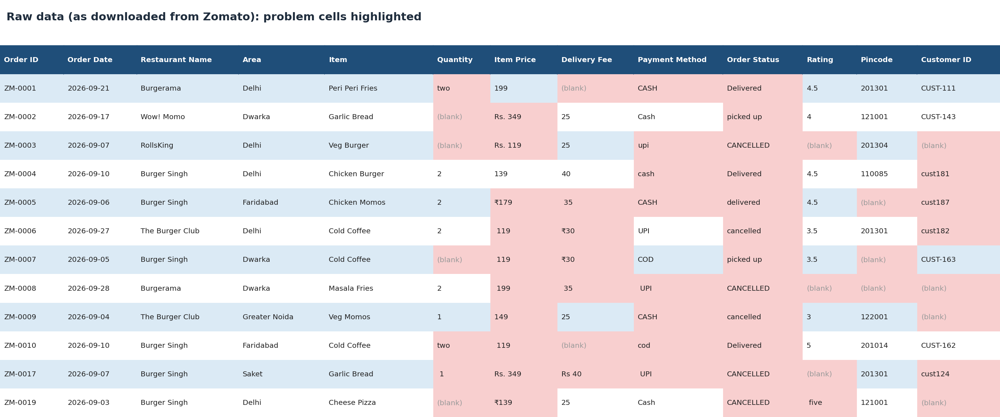
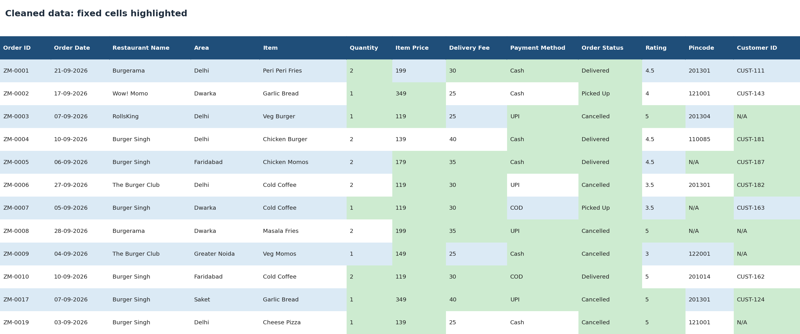
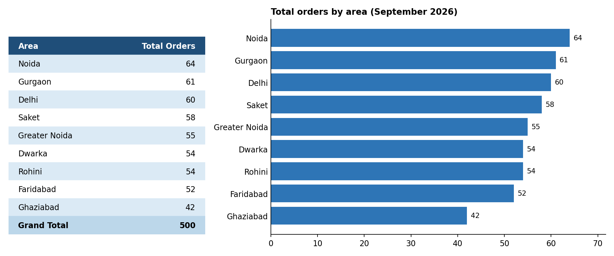

# Zomato Order Data Cleaning & Area-wise Analysis (Excel)

Turned a messy Zomato order report (500 orders, September 2026) into a clean, analysis-ready Excel dataset with an area-wise summary.

**Tools:** Excel (Tables, Text to Columns, Find & Replace, PivotTable, Slicer)

**Download the workbook:** [data_cleaned_zomato.xlsx](data_cleaned_zomato.xlsx)

## The Problem

A restaurant chain with 4 outlets in Delhi NCR gets a messy monthly Zomato report and re-enters the data by hand. They needed it cleaned into proper columns and summarised by area.

## What I Did

- Cleaned 500 rows: fixed text-numbers ("two", "Rs. 349"), blanks, mixed spellings, inconsistent IDs and text dates
- Applied the client's rules for blank values (Quantity = 1, Delivery Fee = Rs. 30, Rating = 5, Pincode and Customer ID = N/A)
- Found 3 duplicate Order IDs, kept the rows, and flagged them for client confirmation
- Verified every cleaned row against the raw data
- Built an area-wise PivotTable that refreshes with new monthly data

## Before and After

A sample of 12 rows from the workbook. Highlighted cells show what was fixed.

**Raw data**

**Cleaned data**

## Result

Area-wise order summary across 9 areas. Noida leads with 64 orders and Ghaziabad is lowest with 42.

<b>Details: cleaning steps and assumptions</b>

### Cleaning steps

| Problem found | What I did | Rows |
|---|---|---|
| Blank Quantity | Set to 1 | 49 |
| Quantity as text ("two", " 1 ") | Converted to numbers | 99 |
| Item Price with "Rs.", "₹", spaces | Removed symbols, converted to numbers | 387 |
| Blank Delivery Fee | Set to Rs. 30 | 97 |
| Delivery Fee with "Rs", "₹", spaces | Removed symbols, converted to numbers | 156 |
| Blank Rating | Set to 5 | 110 |
| Rating as text ("five") | Converted to numbers | 50 |
| Blank Pincode | Set to "N/A" | 65 |
| Blank Customer ID | Set to "N/A" | 177 |
| Customer ID in two formats (`CUST-111`, `cust181`) | Standardised to `CUST-181` | 161 |
| Payment Method, 10 variants | Standardised to 4 values | 310 |
| Order Status, 9 variants | Standardised to 3 values | 324 |
| Order Date stored as text | Converted to real dates | 500 |
| Duplicate Order IDs (ZM-0049, 0149, 0249) | Kept rows, assigned the missing IDs ZM-0050, 0150, 0250 | 3 |

### Assumptions

Client rules for blanks: Quantity = 1, Delivery Fee = Rs. 30, Rating = 5, Pincode = N/A, Customer ID = N/A.

My own decision: the duplicate Order IDs were treated as separate orders (each pair had a different restaurant, customer or item) and given the three IDs missing from the ZM-0001 to ZM-0500 sequence. To be confirmed with Zomato.

## Files

- [`data_cleaned_zomato.xlsx`](data_cleaned_zomato.xlsx): client brief, raw data, assumptions, cleaned data and area summary
- [`images/`](images): preview images used above

## What I Learned

A bulk Find & Replace without "Match case" can silently damage data, and a PivotTable filter left on can make a summary quietly wrong. I now verify totals against the source after every bulk edit.
